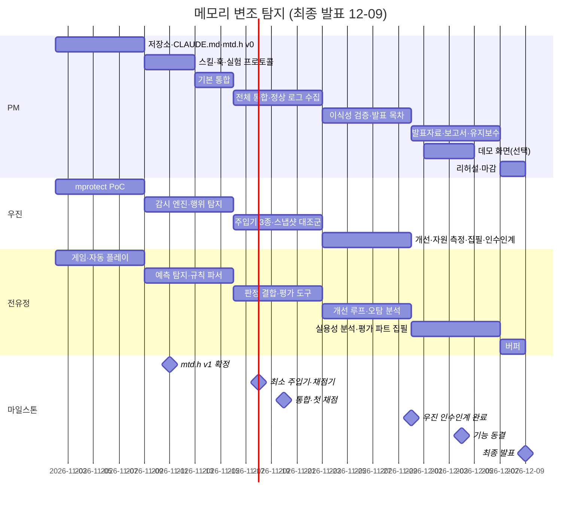

# 프로젝트 계획

주제: 행위 기반 탐지와 예측을 통한 메모리 변조 탐지 알고리즘
플랫폼: Linux (팀원 환경이 다르면 Docker/VM으로 통일)
대상 프로그램: 직접 만든 터미널 지뢰찾기 게임

## 1. 구현 목표 (확정 2026-11-02)

**최종 목표**
Linux에서 실행 중인 지뢰찾기 게임의 핵심 변수에 대해, 외부 프로세스의 메모리 변조를
- 행위 기반: 바뀔 타이밍이 아닌데 바뀌었는가
- 예측 기반: 예측한 값과 다르게 바뀌었는가

두 기준으로 실시간 탐지하는 도구를 구현하고, 탐지 성능과 추가 자원 사용량을 측정해 실용성을 판단한다.

**감시 대상 변수**
| 변수 | 정상 동작 | 변조 예시 |
|---|---|---|
| 타이머 | 1초마다 +1 | 0으로 되돌리기, 멈추기 |
| 남은 지뢰 카운터 | 깃발 꽂을 때 -1, 뺄 때 +1 | 임의 값으로 바꾸기 |
| 지뢰 배치 | 첫 클릭 후 게임 끝까지 불변 | 지뢰 제거·이동 |
| 칸 상태 | 플레이어 입력이 있을 때만 바뀜, 열린 칸은 다시 닫히지 않음 | 입력 없이 칸 열기 |
| 열린 칸 수 | 단조 증가, 칸 상태와 일치 | 값 부풀리기 |
| 게임 상태 | 승리는 모든 안전 칸을 연 경우만 | 바로 승리로 바꾸기 |

**세부 목표**
| 구분 | 목표 |
|---|---|
| 탐지율 | 타이밍 위반형·값 위반형 변조 90% 이상 |
| 오탐률 | 정상 플레이 10분 동안 판정 중 1% 이하 |
| 탐지 지연 | 변조 후 100ms 이내 |
| 자원 오버헤드 | 감시 변수 10개 기준 CPU +10% 이하, 메모리 +20MB 이하 |
| 이식성 | 새 프로그램에 붙일 때 코드 수정 20줄 이하, 지뢰찾기 외 프로그램 1개에 실제 적용 |
| 실용성 판단 | 감시 대상(칸 수 포함)을 늘려 가며 오버헤드 증가 곡선 측정, 쓸 만한 규모 결론 |

**범위 밖**
- 커널 권한 공격, 탐지기 자체 무력화, 실제 상용 프로그램 적용
- 정상 패턴을 흉내 내는 은닉형 변조는 탐지율 목표에서 빼고 한계로 측정·보고

## 2. 구현할 기능 (확정 2026-11-02)

**구조 결정**: 탐지기는 게임에 링크하는 **범용 라이브러리**(가칭 `libmtd`)로 만든다. 지뢰찾기는 첫 번째 사용처일 뿐, 라이브러리 코드에 게임 지식을 넣지 않는다.

**이식성 원칙**
- C API(C ABI)만 공개 → C/C++에서 바로, 다른 언어는 FFI로 사용
- 의존성은 libc·pthread만, CMake로 정적/공유 라이브러리 둘 다 빌드
- 프로그램별 지식(변수 규칙)은 코드가 아니라 **규칙 파일**(JSON)에 둔다. 파서는 단일 파일 라이브러리(예: cJSON)를 소스에 포함해 외부 의존성을 만들지 않는다
- 적용 방법: ① 감시 변수 등록 ② 정상 변경 구간 표시 ③ 규칙 파일 로드 — 이 세 가지만

**API 초안**
```c
mtd_init("rules.json", on_alert);           // 초기화 + 알림 콜백
void *p = mtd_alloc(size);                  // 감시 전용 페이지에 변수 배치 (mprotect 오탐 방지)
mtd_watch(&g.timer, sizeof g.timer, "timer");
mtd_begin("tick"); g.timer++; mtd_end();    // 정상 변경 구간 표시
mtd_event("input");                          // 행위 판단용 이벤트 알림
mtd_shutdown();
```

**기능 목록**
| ID | 기능 | 담당 | 우선순위 |
|---|---|---|---|
| L1 | 라이브러리 코어·공개 API (등록, 구간 표시, 이벤트, 알림 콜백) | 우진 | 필수 |
| L2 | 메모리 감시 엔진 (mprotect 방식 기본, 스냅샷 비교 방식 대조군) | 우진 | 필수 |
| L3 | 행위 기반 탐지 (`mtd_begin`/`mtd_end` 정상 변경 구간·이벤트 밖의 쓰기 탐지) | 우진 | 필수 |
| L4 | 예측 기반 탐지 (변수별 예측 규칙, 변수 간 일관성 검사) | 전유정 | 필수 |
| L5 | 규칙 파일 파서·판정 결합·로그 | 전유정 | 필수 |
| T1 | 지뢰찾기 게임 (터미널, 난이도 3종, 자동 플레이 모드: 안전한 칸을 무작위로 여는 봇) | 전유정 | 필수 |
| T2 | 변조 주입기 (외부 프로세스 메모리 쓰기, 시나리오 3종, 정답 라벨) | 우진 | 필수 |
| T3 | 평가 도구 (자동 채점, 그래프) | 전유정 | 필수 |
| T5 | 자원 측정 (감시 대상 수별 CPU·RSS·대상 지연) | 우진 | 필수 |
| T4 | 이식성 검증: API 문서만 보고 두 번째 프로그램(예: 인벤토리/잔고 앱)에 적용 | PM | 필수 |
| H1 | 개발 하네스 (CLAUDE.md, docs, 스킬, 훅) + API 명세 문서 | PM | 필수 |
| I1 | 통합: 빌드·링크, 게임에 libmtd 적용, 전체 실행 흐름(게임 → 주입기 → 탐지 → 채점), 통합 테스트·CI | PM | 필수 |
| D1 | 데모 화면 (게임 + 실시간 탐지 알림) — 밀리면 터미널 로그 시연으로 대체 | PM | 선택 |

## 3. 전체 업무 프로세스 (확정 2026-11-02)
```
① 기반 준비 → ② 정상 동작 모델링 → ③ 탐지기 개발 → ④ 변조 실험·채점
                                          ↑                  │ 목표 미달
                                          └──────────────────┘
④ 목표 달성 → ⑤ 자원 측정·실용성 분석 → ⑥ 이식성 검증 → ⑦ 발표·보고
```
- ① 하네스, API 헤더(`mtd.h`), 규칙 파일 형식 확정 — 이후 우진·전유정 병렬 개발
- ② 게임 + 자동 플레이로 정상 로그 수집, 변수별 규칙 정리
- ③ 감시 엔진 → 행위·예측 탐지 → 결합
- ④ 주입기 시나리오로 공격, 정답 라벨로 자동 채점 (탐지율 90%↑, 오탐 1%↓ 미달 시 ③으로)
- ⑤ 감시 대상 수별 오버헤드 측정 → ⑥ 두 번째 앱 적용 → ⑦ 발표
- ⑥ 이식성 검증은 API만 쓰므로 ④ 개선 루프와 병행 가능

## 4. 간트차트 (최종 발표 2026-12-09 수, 약 5주)

매주 = 스프린트 1개 (월 시작, 일 마감). 운영 방식과 스프린트별 목표는 `docs/sprints/README.md`.

**일정 제약**
- 우진은 12월 초부터 참여 불가 → 우진 작업은 11-29(일)까지 끝내고 11-30(월)에 인수인계 완료
- 12-01부터 감시 엔진·행위 탐지 모듈의 유지보수는 PM이 맡는다 (통합 원칙의 예외)

**범위**
- 필수: 2장의 필수 기능 전부. 은닉형 시나리오는 주입기 3종에 포함
- 선택: 데모 화면(밀리면 터미널 로그 시연), 학습 기반 행위 프로필(4주차에 여유 있으면)
- 행위 기반 탐지는 `mtd_begin`/`mtd_end` 정상 변경 구간 방식으로 구현한다 — 학습 없이 동작하므로 2주차에 만들 수 있다
- 기능 동결 12-04(금). 이후에는 코드 수정 없이 측정 재실행·분석·발표만

| 주차 | 기간 | PM (윤태건) | 우진 | 전유정 |
|---|---|---|---|---|
| 1 | 11-02 ~ 11-08 | 저장소·루트 CLAUDE.md, `mtd.h` v0·규칙 형식 | mprotect 감시 PoC | 게임 + 자동 플레이(안전한 칸을 무작위로 여는 봇) |
| 2 | 11-09 ~ 11-15 | 스킬·훅·모듈별 CLAUDE.md, 실험 프로토콜, 기본 통합 시작(11-13~) | 감시 엔진·API 코어, 행위 기반 탐지(구간 방식) | 예측 기반 탐지, 규칙 파서 (가짜 이벤트로 개발) |
|   | **11-11 (수)** | **`mtd.h` v1 확정** (PoC 결과 반영) | | |
| 3 | 11-16 ~ 11-22 | 전체 실행 흐름 통합·통합 테스트, 정상 로그 수집 | 변조 주입기 3종(최소 버전 11-18), 스냅샷 대조군 | 판정 결합, 평가 도구(최소 채점기 11-18) |
|   | **11-20 (금)** | **통합·첫 채점** | | |
| 4 | 11-23 ~ 11-29 | 이식성 검증(두 번째 앱), 매일 통합 확인, 발표 목차 | 개선 루프·최적화, 자원 측정, 구현 파트 집필, 인수인계 문서 | 개선 루프(예측·결합), 오탐 분석 |
|   | **11-30 (월)** | **우진 인수인계 완료** (마지막 참여일) | | |
| 5 | 11-30 ~ 12-06 | 발표자료, 보고서 통합, 우진 모듈 유지보수, 데모 화면(선택) | — | 실용성 분석·그래프, 평가 파트 집필 |
|   | **12-04 (금)** | **기능 동결** | | |
| 6 | 12-07 ~ 12-08 | 리허설, 자료 마감 | — | 버퍼 |
|   | **12-09 (수)** | **최종 발표** | | |

**인수인계 (11-30까지, 우진 → PM)**
- `monitor/`·행위 탐지 모듈의 `CLAUDE.md`를 최신으로: 구조, 알려진 한계, 자주 나는 버그와 대처
- 자원 측정 실행 방법과 마지막 측정 결과 CSV
- 구현 파트 원고와 발표용 구조 그림
- 열린 이슈 목록 (GitHub Issues)



통합 원칙: 통합 중 발견한 모듈 내부 버그는 PM이 고치지 않고 담당자에게 넘긴다. 판정 결합 로직(L5)은 전유정 담당. 예외: 12-01 이후 우진 모듈은 PM이 유지보수한다.
